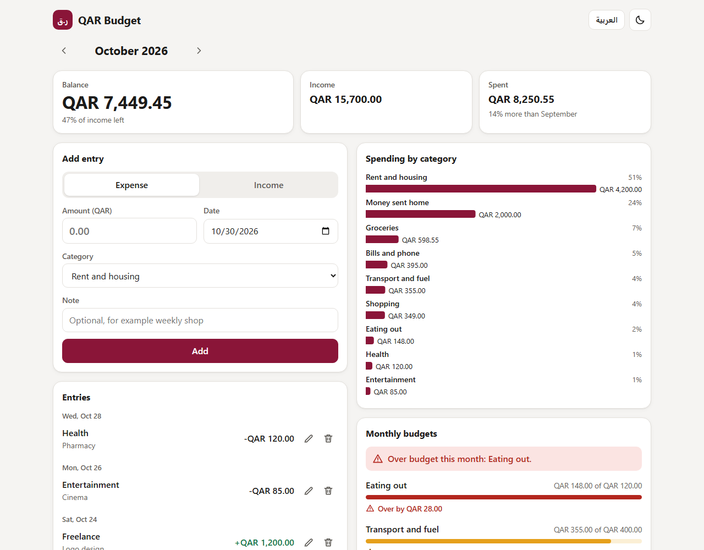
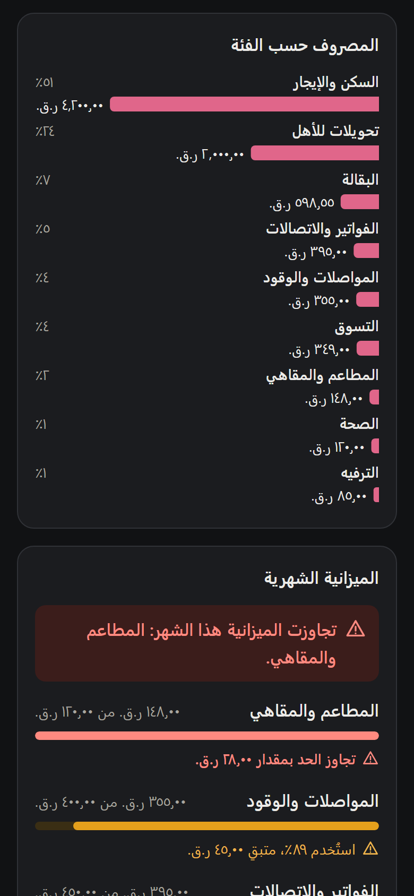

# QAR Budget

A budget tracker in Qatari riyals for people living in Qatar, in English and Arabic. Use it at [ifazawezk.github.io/qar-budget](https://ifazawezk.github.io/qar-budget/).

There is no account and no server: your entries live only in your own browser's `localStorage`. Clearing the site's data deletes them, so export a JSON backup now and then.





## What it does

You add income and expenses with an amount in QAR, a category, a date and an optional note. The form starts on the category you used last for that type. Entries can be edited or deleted later; saving or cancelling an edit takes you back to the row, and a delete can be undone.

Each month shows income, spending and balance, how spending compares with last month, and a bar chart by category. The arrows move between months. You can set a monthly budget per category; one at 80% or more of its limit, or over it, gets a warning with an icon and text as well as a color.

The categories fit life in Qatar, with rent, money sent home, transport and fuel, and bills and phone among them. Every expense in "Money sent home" adds up to a yearly total for the year of the month on screen, with a chart per month and its share of the year's income. Recurring transfers count too.

Recurring entries cover rent, salary and bills, every month or every week. Entries that have fallen due are added when you open the app, including any missed while it was closed. Each one is a normal entry you can edit or delete, and a deleted one stays deleted. A schedule can be paused, edited or deleted at any time; paused dates are skipped, not added later when you resume. A schedule on the 31st uses the last day of shorter months and goes back to the 31st afterwards.

Arabic gets a right-to-left layout. Amounts are formatted with `Intl.NumberFormat` for `en-QA` and `ar-QA`, so the Arabic screen shows Arabic digits and ر.ق. Amount fields take Arabic digits (١٢٥٫٥) and a phone keypad's decimal comma: 45,50 is 45.50, while 1,250 stays one thousand two hundred and fifty. A comma that could mean either, such as 1,25.50, is refused.

There's a light and a dark mode, following your system setting until you pick one. You can export a JSON backup or a CSV file and import either back. Imports skip entries you already have, so importing the same file twice doesn't create duplicates. JSON backups also hold budgets and recurring entries; CSV holds entries only.

Stored data carries a schema version. Data saved by an older version is upgraded when the app loads, and anything that can't be read is copied to a backup key instead of being thrown away.

## Offline and installing

After one visit online, the app opens with no connection and you can add, change and export entries as usual. To install it, use "Add to Home screen" in Chrome on Android, or "Add to Home Screen" in Safari's share menu on iPhone. On a laptop, Edge and Chrome show an install button in the address bar. Installing from the Arabic screen gives the app its Arabic name.

On iPhone an installed app usually has its own storage, separate from Safari. If your entries aren't there after installing, use "Export JSON" in Safari and "Import file" in the installed app.

Online, the app opens the newest version straight away. If a new version arrives while it's open, a notice offers a reload so it doesn't interrupt your typing. On a connection that doesn't answer, it opens from its saved copy after four seconds.

## Run it locally

You need Node.js 22.12 or newer, or Node 20 from 20.19 on.

```bash
npm install
npm run dev
```

Vite prints the address, usually http://localhost:5173/qar-budget/. For test data, use "Import file" with `examples/sample.csv`, which has made-up entries for September and October 2026.

```bash
npm run build
npm run preview
```

The service worker only runs in a production build, so test offline use with `npm run preview`, not `npm run dev`.

## Tests

```bash
npm test
```

The logic is in plain TypeScript modules in `src/lib` that don't touch the DOM, and Vitest tests them directly: amount parsing and formatting, monthly totals, budgets, recurring dates including month ends, yearly money sent home, CSV, merging imports and storage migrations. `src/ui` only turns that into HTML and SVG. `npm run build` also runs the TypeScript compiler in strict mode.

Two browser checks run in headless Edge, need Edge and Node 22 or newer, and are separate from `npm test`:

```bash
npm run check:offline
```

```bash
npm run check:phone
```

`check:offline` builds the app and serves it from a local server that behaves like GitHub Pages. It covers a first visit, no connection (the server is really stopped), a connection that never answers, a new deploy with the app open, a broken deploy, and a new deploy with the app closed.

`check:phone` uses the app on a touch screen 390, 360 and 320 pixels wide, in English and Arabic, with real touch events and typed text. It covers decimal-comma amounts, adding and editing entries, forms staying in view, buttons big enough for a finger, and no sideways scrolling.

Neither has run on a real phone. Installing from a phone's browser is untested, and so are the on-screen keyboard and the phone's own date and category pickers. A headless browser has no on-screen keyboard, so the phone check only confirms that the amount field doesn't take focus again after adding.

## CSV format

```csv
date,type,category,amount,note
2026-10-01,income,salary,14500.00,October salary
2026-10-05,expense,groceries,412.30,Weekly shop
```

`date` is `YYYY-MM-DD`, `type` is `income` or `expense`, and `amount` is a positive number with up to two decimals. `category` is one of these ids, and any other id is kept and shown as it is:

- income: `salary`, `allowance`, `freelance`, `other-income`
- expense: `housing`, `groceries`, `dining`, `transport`, `bills`, `remittance`, `health`, `education`, `shopping`, `entertainment`, `travel`, `other-expense`

Column order doesn't matter and extra columns are ignored. Rows with a problem are skipped and listed by line number after the import. Exported files start with a byte order mark so Excel opens Arabic notes correctly. Notes that start with `=`, `+`, `-` or `@` get a leading apostrophe so a spreadsheet doesn't run them as formulas; the import removes it again.

## Code layout

```
src/lib    budget logic, storage and file formats, with tests next to each module
src/ui     the views: form, list, charts, budgets, recurring entries, money sent home, import and export
src/main.ts
src/sw.ts  the service worker
public/    web app manifests in English and Arabic, and icons
scripts/   the headless Edge offline and phone checks
examples/  a sample CSV file
```

`vite.config.ts` bundles `src/sw.ts` to `sw.js` with the list of files in that build and a version made from their contents, so any change in a deploy changes `sw.js` and browsers notice. Opening the app asks the network first and falls back to the saved copy after four seconds. Only an install writes to the cache, all or nothing, so the saved page always matches its assets and a broken deploy leaves the previous version working offline. Cache names start with `qar-budget-` and cleanup only touches those, because all of a user's GitHub Pages project sites share one origin.

## Deploying

`vite.config.ts` sets `base` to `/qar-budget/`, so the `dist` folder from `npm run build` can go to GitHub Pages for a repository named `qar-budget`. Publish all of it and keep `sw.js` at the top of the site, since that address is how browsers find updates. The manifest paths and service worker follow `base`, except the `id` in the two manifest files, which has to be changed by hand if the base changes.

## License

MIT. See [LICENSE](LICENSE).
