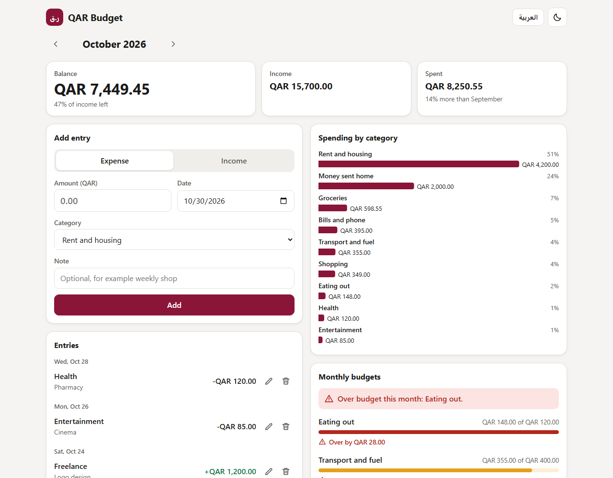
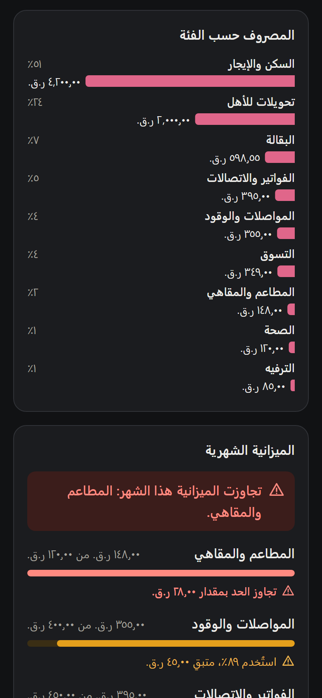

# QAR Budget

A simple budget tracker for people living in Qatar. Write down what comes in and what goes out in Qatari riyals, see where the month's money went, and set a monthly limit for the categories you care about. It works in English and Arabic, on a phone or a laptop.

There is no account and no server. Everything is saved in your own browser.





## Features

- Add income and expenses with an amount in QAR, a category, a date and an optional note. Edit or delete them later; a delete can be undone.
- A monthly view with income, spending and balance, how this month's spending compares with last month, and a bar chart of spending by category. Use the arrows to move between months.
- A monthly budget per category with progress bars. A category close to its limit (80% or more) or over it gets a warning with an icon and text, not only a color.
- A yearly total of the money you sent home, with a chart of each month and how much of the year's income it was. It adds up every expense in the "Money sent home" category for the year of the month on screen, so nothing extra needs entering, and a recurring transfer counts too.
- Recurring entries for things like rent, salary and bills, every month or every week. Entries that have fallen due are added when you open the app, including any missed while it was closed. Each one is a normal entry you can edit or delete, and a deleted one stays deleted. You can pause, edit or delete a schedule at any time. Pausing skips those dates; they are not added later when you resume. A schedule on the 31st uses the last day of shorter months and goes back to the 31st afterwards.
- Installs on a phone or laptop and opens with no connection after your first visit.
- Categories that fit life in Qatar, such as rent, money sent home, transport and fuel, and bills and phone.
- English and Arabic, with a right-to-left layout for Arabic. Amounts are formatted with `Intl.NumberFormat` for `en-QA` and `ar-QA`, so the Arabic screen shows Arabic digits and ر.ق. Amount fields accept Arabic digits as well, so typing ١٢٥٫٥ works.
- Light and dark mode. It follows your system setting until you choose one.
- Export a JSON backup or a CSV file, and import either one back. Importing skips entries you already have, so importing the same file twice does not create duplicates. JSON backups also hold budgets and recurring entries; CSV files hold entries only.
- Data is stored in `localStorage` with a schema version. Data saved by an older version is upgraded when the app loads, and anything that cannot be read is copied to a backup key instead of being thrown away.

## Install it and use it offline

Open the site once while online. After that it opens with no connection, and you can add, change and export entries as usual.

To install it, use "Add to Home screen" in Chrome on Android, or "Add to Home Screen" in the share menu of Safari on iPhone. On a laptop, Edge and Chrome show an install button in the address bar. Installing from the Arabic screen gives the app its Arabic name.

- Your data is still only in that browser, and clearing the site's data removes it, so keep a JSON backup.
- On iPhone an installed app has usually kept its own storage, apart from Safari. If your entries are not there after installing, use "Export JSON" in Safari and "Import file" in the installed app.
- When you are online the app opens the newest version straight away. If a new version arrives while the app is already open, a notice offers a reload, so it never interrupts what you are typing.
- On a connection that does not answer, the app opens from its saved copy after four seconds.

## Run it locally

You need Node.js 22.12 or newer. Node 20 also works from 20.19 on.

```bash
npm install
npm run dev
```

Then open the address Vite prints, usually http://localhost:5173/qar-budget/.

To try it with some data, use "Import file" and pick `examples/sample.csv`. It has made-up entries for September and October 2026.

For a production build:

```bash
npm run build
npm run preview
```

The service worker only runs in a production build, so try offline use with `npm run preview`, not `npm run dev`.

## Tests

```bash
npm test
```

All the logic lives in plain TypeScript modules in `src/lib` that do not touch the DOM, so Vitest tests them directly: amount parsing and formatting, monthly totals, budgets, recurring dates including month ends, yearly money sent home, reading and writing CSV, merging imports, and the storage migrations. The code in `src/ui` only turns that into HTML and SVG.

`npm run build` also runs the TypeScript compiler in strict mode.

To check offline use in a real browser:

```bash
npm run check:offline
```

This builds the app and runs it in headless Edge against a local server that behaves like GitHub Pages. It covers a first visit, no connection, a connection that never answers, a new deploy with the app open, a broken deploy, and a new deploy with the app closed. "No connection" means the server is really stopped. It needs Edge and Node 22 or newer, and it is separate from `npm test`. It has not been run on a real phone, so installing from a phone's browser is untested.

## How offline use works

`src/sw.ts` is a small service worker. `vite.config.ts` bundles it to `sw.js` and writes in the list of files in that build, with a version made from their contents, so a deploy that changes any file also changes `sw.js` and browsers notice.

- Opening the app asks the network first. The saved copy is used when that fails or takes more than four seconds, so a deploy shows up as soon as it can be reached and an old version cannot get stuck.
- Only an install writes to the cache, and it keeps everything or nothing. The saved page therefore always matches its assets, and if a deploy is broken the previous version keeps working offline.
- Cache names start with `qar-budget-` and the cleanup only touches those, because all of a user's GitHub Pages project sites share one origin.

The manifest paths and the service worker are relative to where they are served, so they follow `base` in `vite.config.ts`, except the `id` in the two manifest files, which has to be changed by hand if the base ever changes.

## CSV format

```csv
date,type,category,amount,note
2026-10-01,income,salary,14500.00,October salary
2026-10-05,expense,groceries,412.30,Weekly shop
```

- `date` is `YYYY-MM-DD`.
- `type` is `income` or `expense`.
- `category` is one of these ids. Income: `salary`, `allowance`, `freelance`, `other-income`. Expenses: `housing`, `groceries`, `dining`, `transport`, `bills`, `remittance`, `health`, `education`, `shopping`, `entertainment`, `travel`, `other-expense`. Other ids are kept and shown as they are.
- `amount` is a positive number with up to two decimals.
- The order of the columns does not matter and extra columns are ignored. Rows with a problem are skipped and listed by line number after the import.

Exported CSV files start with a byte order mark so Excel opens Arabic notes correctly. Notes that start with `=`, `+`, `-` or `@` get a leading apostrophe so a spreadsheet does not run them as formulas; the import removes it again.

## Project layout

```
src/lib    budget logic, storage and file formats, with tests next to each module
src/ui     the views: form, list, charts, budgets, recurring entries, money sent home, import and export
src/main.ts
src/sw.ts  the service worker
public/    web app manifests in English and Arabic, and icons
scripts/   the headless Edge offline check
examples/  a sample CSV file
```

## Deploying

`vite.config.ts` sets `base` to `/qar-budget/`, so the `dist` folder from `npm run build` can be published to GitHub Pages for a repository named `qar-budget`. Publish all of it, and keep `sw.js` at the top of the site: that address is how browsers find updates.

## License

MIT. See [LICENSE](LICENSE).
